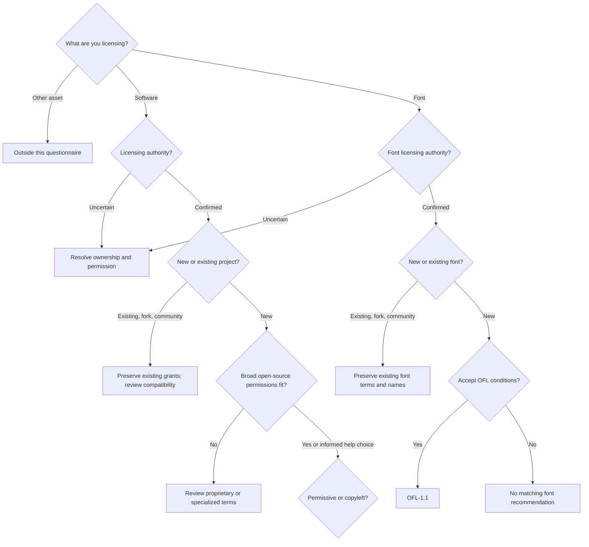
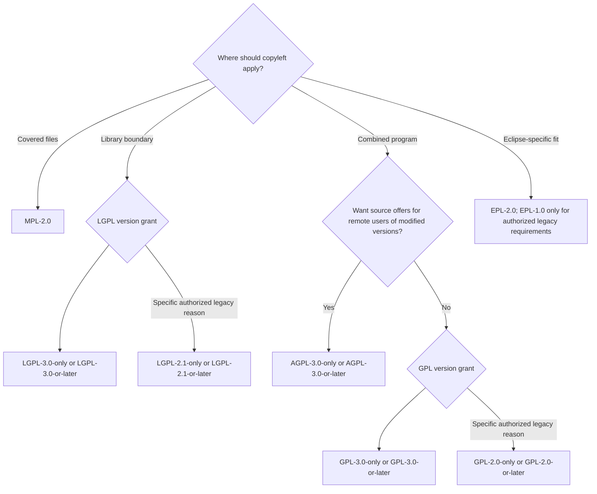

# Licensing questionnaire

The CLI uses a static multi-choice graph in `src/tree.zig`. It asks about the work, licensing authority, existing constraints, and intended obligations before recommending terms. `src/licenses.zig` supplies all 23 canonical identifiers and their obligations to both recommendation and compatibility modes.

## Entry and constraints

Ownership is not inferred from asset type. Existing-project guidance is deliberately not a license replacement operation: copyright owners, contributor authority, original notices, existing grants, and dependency compatibility must be considered first. Documentation, images, and datasets have an explicit out-of-scope outcome rather than a misleading software-ownership warning.

The font path requires accepting OFL redistribution under the same license, notices, Reserved Font Name rules, and the restriction on selling fonts by themselves. Documents created with the fonts do not inherit OFL. Its help menu explains the conditions before offering accept/refuse again.

## New software choices

The common path takes six selections: software, authority, new work, open-source permissions, permissive model, then MIT or Apache-2.0. These common choices are not a ranking of every license by legal strength. Advanced permissive choices expose BSD-2-Clause, BSD-3-Clause, ISC, 0BSD, Boost (`BSL-1.0`, not Business Source License), Zlib, and Unlicense with their distinguishing terms.

MIT requires retaining notices; Apache adds an express contributor patent grant, change notices, and applicable NOTICE attributions. 0BSD waives notice-copy requirements without dedicating copyright. Unlicense attempts a public-domain dedication with a fallback permission. Boost exempts solely machine-executable distributions from its notice condition; Zlib adds origin integrity and altered-source marking rules. BSD-3-Clause adds an express no-endorsement clause.

The copyleft scope menu makes the architectural distinction explicit:

GNU later-version permission is always explicit, never inferred from a bare identifier or existing version. Legacy options on the new-work path are for an authorized compatibility/project reason; they do not upgrade or replace third-party grants. LGPL-2.1's GPL conversion option is distinct from upgrading an LGPL-2.1-only grant to LGPL-3.0.

Ordinary copyleft concerns covered distributions, not publication of every private modification. GPL covers combined programs, LGPL provides library-boundary permissions subject to source/relinking conditions, and MPL covers files while separate files may differ. Merely operating a server is not a reason to force AGPL: the questionnaire asks whether its additional network source-offer obligation is intended. EPL has its own contribution, patent, and commercial-distributor obligations; it is not a generic business-friendly fallback.

Help choices explain the model and offer informed choices rather than interpreting uncertainty as a negative answer. Every recommendation shows a rationale, obligations/limitations, and the SPDX text link. Typed advisory outcomes have no fake license link. Back/restart/quit work at all outcomes.

## Presentation and compatibility

Optional Gum owns each menu's frames. The questionnaire clears the terminal viewport before rendering the next question, recommendation, or advisory, including Back and Restart. Numbered prompts without Gum use the same replacing view. This avoids guessing line counts for wrapped text or Gum frames. Redirected streams and `TERM=dumb` instead retain an append-only transcript without terminal controls. Both presentations consume the same graph; recommendations do not depend on whether Gum is installed. See the [README](./README.md#optional-terminal-menus) for installation and controls.

`--compat` remains a separate assessment of existing license combinations, not a fresh recommendation or a promise that components can be relicensed. It considers all inputs, preserves original obligations, and explains conditional file/library/font/module boundaries. Plain mode accepts canonical SPDX lists; Gum provides searchable multi-selection. Compound expressions, exceptions, unlisted versions, jurisdiction-specific issues, and actual source-combination facts remain outside the model.

## Authoritative references

- [GNU license selection guidance](https://www.gnu.org/licenses/license-recommendations.html), [license list](https://www.gnu.org/licenses/license-list.html), and [compatibility FAQ](https://www.gnu.org/licenses/gpl-faq.html#AllCompatibility).
- [Existing project and community guidance](https://choosealicense.com/community/).
- [Apache-2.0 text](https://www.apache.org/licenses/LICENSE-2.0.txt).
- [MPL FAQ](https://www.mozilla.org/en-US/MPL/2.0/FAQ/) and [MPL-2.0 section 3.3](https://spdx.org/licenses/MPL-2.0.html).
- [LGPL-2.1 section 3](https://www.gnu.org/licenses/old-licenses/lgpl-2.1.html), [GPL-3.0 section 13](https://spdx.org/licenses/GPL-3.0-only.html), and [EPL-2.0 section 3.2 / Exhibit A](https://spdx.org/licenses/EPL-2.0.html).
- [Boost](https://www.boost.org/LICENSE_1_0.txt), [Zlib](https://spdx.org/licenses/Zlib.html), and [official OFL text](https://openfontlicense.org/open-font-license-official-text/).

This is general guidance, not legal advice. Review actual license texts, grants, notices, and how code is combined.
